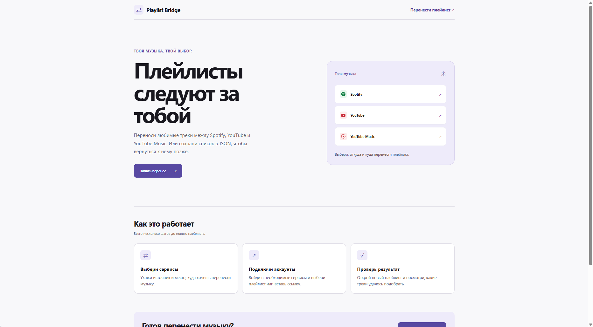
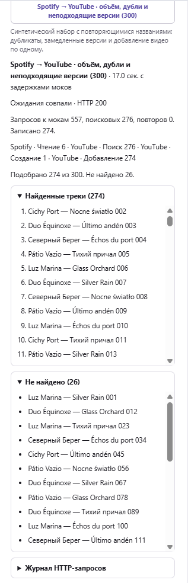
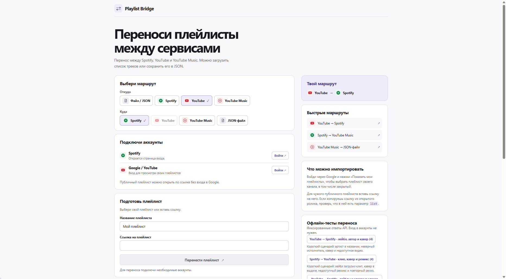

# Playlist Bridge

Веб-приложение для переноса плейлистов между Spotify, YouTube и YouTube Music. Список треков также можно загрузить из JSON или сохранить в JSON для повторного импорта.

Проект создан для изучения Go, работы с API и сопоставления музыкальных записей. Его можно посмотреть локально **без аккаунтов и API-ключей**: для этого есть демонстрационные сценарии с подготовленными ответами сервисов.

## Что умеет

- Переносить плейлисты между поддерживаемыми сервисами и показывать найденные и ненайденные позиции.
- Открывать публичные плейлисты YouTube по ссылке и выбирать доступные плейлисты подключённых аккаунтов.
- Импортировать и экспортировать треки в JSON.
- Сопоставлять треки по доступным метаданным, учитывая варианты оформления названия и версии записи.
- Запускать офлайн-сценарии YouTube → Spotify и Spotify → YouTube с журналом условных запросов и сравнением с ожидаемым результатом.

Совпадение записей не гарантируется: каталоги сервисов различаются, а название ролика и имя канала не всегда содержат точные метаданные.



## Как работает приложение

Пользователь выбирает источник и сервис назначения на странице переноса. В зависимости от направления можно указать ссылку на плейлист, выбрать доступный плейлист подключённого аккаунта или загрузить список из JSON. Для публичного плейлиста YouTube достаточно ссылки и настроенного API-ключа; для работы с аккаунтом и создания плейлиста нужен вход в соответствующий сервис.

Вход в Spotify и Google проходит через OAuth: пользователь подтверждает доступ на стороне сервиса, а приложение получает токен для разрешённых операций. Сессии и токены хранятся в памяти сервера; после его перезапуска или окончания действия токена аккаунт нужно подключить снова.

Интерфейс на React отправляет запрос серверу на Go. Сервер проверяет данные и доступ к нужным аккаунтам, читает исходный плейлист через API и передаёт записи в общий механизм переноса. После подбора сервер создаёт плейлист в выбранном сервисе, добавляет найденные записи и возвращает результат на страницу. Если назначение — JSON, приложение выдаёт файл со списком треков вместо создания плейлиста в сервисе.

Сервисы имеют разные способы записи: Spotify добавляет треки пакетами до 100 позиций, YouTube — видео по одному. Эти детали скрыты в адаптерах и API-клиентах; общий подбор работает с единым представлением трека и кандидата. При этом возможности и ограничения каждого провайдера остаются важны: например, YouTube Music может показывать не все видео, а доступ к плейлистам Spotify зависит от прав аккаунта и условий API.

## Как работает перенос

1. **Чтение источника.** Адаптер Spotify, YouTube или JSON получает список и приводит доступные сведения к общему представлению: название, исполнитель, альбом и другие метаданные. У YouTube название исполнителя может находиться в заголовке ролика, а канал — принадлежать лейблу или загрузчику. Адаптер разбирает распространённые форматы заголовка и убирает часть служебных пометок, например `Official Video` и `Lyrics`.
2. **Поиск кандидатов.** Адаптер сервиса назначения формирует запрос и преобразует ответы в общий формат. Для Spotify при наличии ISRC сначала используется поиск по идентификатору; в остальных случаях запрос строится по доступным сведениям о треке. Если в первом ответе нет подходящей записи, адаптер может выполнить один дополнительный текстовый поиск — его условия описаны ниже.
3. **Сопоставление.** Общий алгоритм сравнивает нормализованные названия и исполнителей, учитывает указанных участников и версии записи. Доступные альбом, длительность и ISRC тоже помогают выбрать кандидата. Для подходящих вариантов рассчитывается взвешенная оценка с порогом; если уверенного совпадения нет, трек остаётся ненайденным.
4. **Создание плейлиста.** Найденные записи добавляются в исходном порядке. В результате отдельно отображаются найденные, ненайденные и недоступные в источнике позиции.

Например, ролик `Rock That Body - The Black Eyed Peas (Lyrics)` может быть загружен каналом с другим названием. При подборе важно учесть исполнителя из заголовка и не выбрать одноимённую запись другого артиста. Если источник указывает концертную версию, ремикс или кавер, алгоритм сравнивает и версию записи: студийный оригинал не должен автоматически её заменить.

### Когда Spotify получает дополнительный поисковый запрос

Первый подходящий результат завершает поиск. Если его нет, повторный поиск возможен только при наличии **непустого запроса, отличающегося от первого**:

- После поиска по ISRC допускается текстовый поиск по доступным метаданным.
- В специальном режиме `broad-first` сначала используется широкий текстовый запрос, после чего при необходимости возможен уточнённый.
- В обычном режиме без ISRC дополнительный поиск выполняется, когда в первой выдаче хотя бы у одного кандидата есть нужный исполнитель, но подходящая запись всё ещё не найдена.

Если этих признаков нет, второй текстовый запрос пропускается. Например, когда вместо исполнителя известен только лейбл, а первая выдача не содержит нужного артиста, подходящая запись может остаться ненайденной. Это компромисс между экономией запросов и полнотой поиска. Одинаковые запросы в рамках переноса переиспользуются. Подробнее — в [`spotify_adapter.go`](internal/transfer/spotify_adapter.go).

### Что учитывается при выборе записи

Алгоритм сначала проверяет обязательные признаки: наличие идентификатора результата, совместимость версий и, когда известны оба ISRC, совпадение идентификаторов записи. Затем сравниваются нормализованные названия и исполнители, включая указанных гостей. Различия в оформлении могут быть допустимы, но совпадение одних только слов названия не гарантирует выбор кандидата.

Оценка строится по доступным полям: название и исполнитель дают основные сигналы, совпадение или расхождение альбома и длительности влияет на результат, когда значения есть у обеих записей. Отсутствующее поле само по себе не штрафуется. Среди прошедших проверки кандидатов выбирается лучший по оценке; совпадающий ISRC обрабатывается как сильный признак записи.

Для экономии запросов повторяющиеся записи с одинаковыми сведениями в рамках переноса ищутся один раз, а результаты одинаковых поисковых запросов Spotify и YouTube переиспользуются. Порядок и повторяющиеся позиции при этом сохраняются. Общий перенос допускает до трёх параллельных операций поиска; запросы к Spotify дополнительно выполняются по одному, чтобы учитывать ограничения провайдера. При переносе между YouTube и YouTube Music исходные видео копируются по ID без повторного поиска.

Подбор зависит от полученной выдачи и качества метаданных: алгоритм может не найти правильную запись или выбрать неверную. При ошибке поиска часть позиций может остаться непроверенной; при ошибке добавления уже созданный плейлист остаётся доступным для проверки.

При временных ошибках Spotify `502`, `503` и `504` выполняются короткие повторы. Для `429` приложение учитывает `Retry-After`: короткое ожидание можно повторить, а при длительном ограничении или исчерпанной квоте перенос завершается с ошибкой, чтобы не продолжать отправлять запросы. Повторы ограничены; они не гарантируют восстановление доступа.

### Несколько фрагментов кода

**Общий поиск.** Перенос получает функцию поиска как аргумент. Адаптеры Spotify и YouTube возвращают кандидатов в едином формате, поэтому выбор записи выполняется общей логикой ([`transfer.go`](internal/transfer/transfer.go)):

```go
type Candidate struct {
    Title      string
    Artists    []string
    Album      string
    URI        string
    Explicit   *bool
    DurationMs int    `json:"-"`
    ISRC       string `json:"-"`
}

type SearchFunc func(ctx context.Context, track Track) ([]Candidate, error)
```

**Оценка кандидата.** После проверок названия, исполнителей и версии записи алгоритм рассчитывает оценку. Альбом и длительность влияют на неё только тогда, когда эти данные доступны с обеих сторон ([`match.go`](internal/transfer/match.go), фрагмент функции `selectCandidate`):

```go
score := 60*(title-threshold) + 25*(artistScore-threshold)
if album := matchText(candidate.Album); wantAlbum != "" && album != "" {
    if album == wantAlbum {
        score += 7 * (1 - threshold)
    } else {
        score += 7 * (.65 - threshold)
    }
}
if track.DurationMs > 0 && candidate.DurationMs > 0 {
    score += 22 * (durationSimilarity(track.DurationMs, candidate.DurationMs) - threshold)
}
if score < 0 {
    continue
}
```

**Повторное использование поиска.** В адаптере YouTube одинаковый запрос в пределах одного переноса выполняется один раз: `sync.OnceValues` сохраняет результат и для других записей с тем же запросом ([`youtube_destination.go`](internal/transfer/youtube_destination.go), фрагмент функции `NewYouTubeSearch`):

```go
query := track.Artist + " " + track.Title
mu.Lock()
lookup, ok := queries[query]
if !ok {
    lookup = sync.OnceValues(func() ([]youtube.Video, error) {
        if err := ctx.Err(); err != nil {
            return nil, err
        }
        requests.Add(1)
        return youtube.SearchVideos(ctx, apiKey, query)
    })
    queries[query] = lookup
}
mu.Unlock()
videos, err := lookup()
```

## Демо без ключей

Понадобятся Go версии, указанной в `go.mod`, и Node.js с npm. Из корня проекта:

```powershell
cd web
npm install
npm run build
cd ..
go run -tags playlist_bridge_demo -overlay tests/demo-overlay.json ./cmd/playlist-bridge-web
```

Откройте `http://127.0.0.1:8080/` и перейдите к переносу. В боковой панели находятся кнопки офлайн-тестов. В них используются локальные фиктивные ответы: настоящие API не вызываются, плейлисты в аккаунтах не создаются. Число запросов и время в отчёте относятся к модели, а не к реальным сервисам; часть сценариев намеренно использует задержки.

Демонстрационные сценарии хранятся в `tests/mocks/`. Тег и overlay подключают их при запуске демо. При обычном запуске тестовые HTTP-маршруты отключены.

Пример результата офлайн-сценария:



## Реальный перенос

Для реального переноса необходимы собственные ключи сервисов и доступ к соответствующим API. Доступность Spotify API зависит от режима и условий вашего приложения; у YouTube Data API есть квоты на поиск и запись. Запросы могут быть ограничены провайдером, а отдельные видео или треки — недоступны.

1. Скопируйте `.env.example` в `.env` и заполните нужные значения. Не добавляйте `.env` и секреты в репозиторий.
2. Для Spotify создайте приложение в Spotify Developer Dashboard и укажите адрес возврата `http://127.0.0.1:8080/callback`.
3. Для YouTube включите YouTube Data API v3, настройте Google OAuth и адрес возврата `http://127.0.0.1:8080/callback/google`. Для чтения публичных плейлистов и поиска нужен `YOUTUBE_API_KEY`. При режиме тестирования Google OAuth добавьте свой аккаунт в тестовые пользователи.
4. Соберите интерфейс командами из раздела выше и запустите сервер из корня проекта:

```powershell
go run ./cmd/playlist-bridge-web
```

Откройте `http://127.0.0.1:8080/`, выберите направление и подключите необходимые аккаунты. Сервер рассчитан на локальный запуск; для публикации потребуются дополнительная настройка и проверка безопасности.



Пример JSON:

```json
[
  {"title": "Numb", "artist": "Linkin Park", "album": "Meteora"}
]
```

## Устройство проекта

- `cmd/` — запуск веб-сервера и консольной программы.
- `internal/transfer/` — общий подбор и адаптеры сервисов.
- `internal/spotify/`, `internal/youtube/` — клиенты API.
- `internal/server/` — HTTP-обработчики и авторизация.
- `web/` — интерфейс на React и Vite.
- `tests/` — тесты и данные офлайн-сценариев.

Тесты из корня проекта:

```powershell
go test -tags playlist_bridge_tests -overlay tests/overlay.json ./internal/...
```

Файлы тестов находятся отдельно от исходных пакетов. Overlay подключает их к пакетам, чтобы тестировать и внутренние функции. Для офлайн-демо подготовлены ответы, похожие на выдачу Spotify и YouTube: встречаются каналы лейблов, разные версии записей, повторы, недоступные видео и ошибки API. Результат можно сопоставить с разметкой сценария и посмотреть журнал условных запросов. Моки помогают воспроизводить конкретные ситуации без расхода квоты, но не являются оценкой качества на всех возможных плейлистах.

Интеграции Яндекс Музыки, SoundCloud и VK на данный момент не заявлены как готовые функции.
